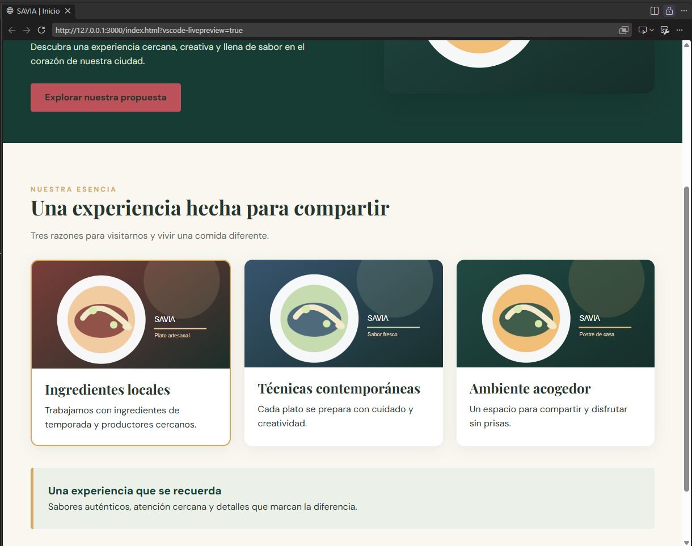
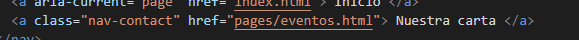
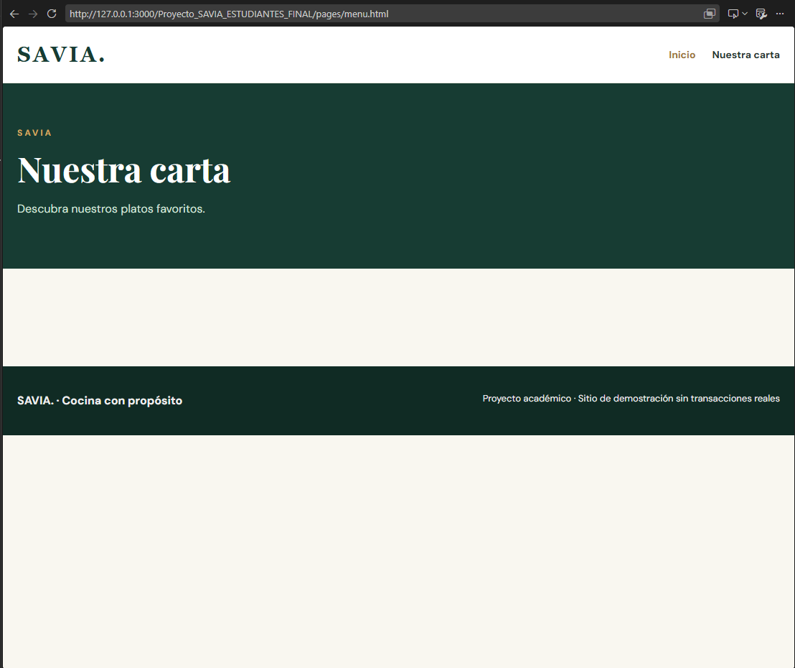
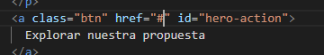
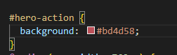
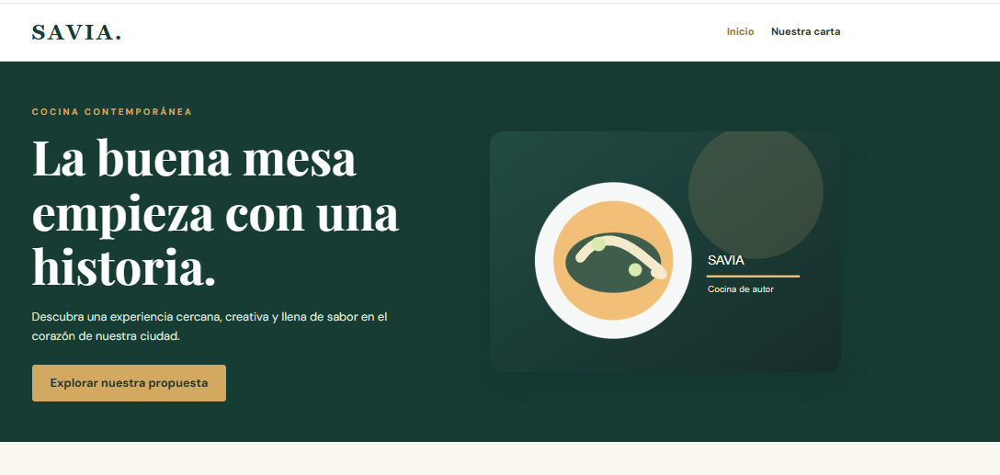
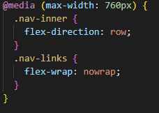
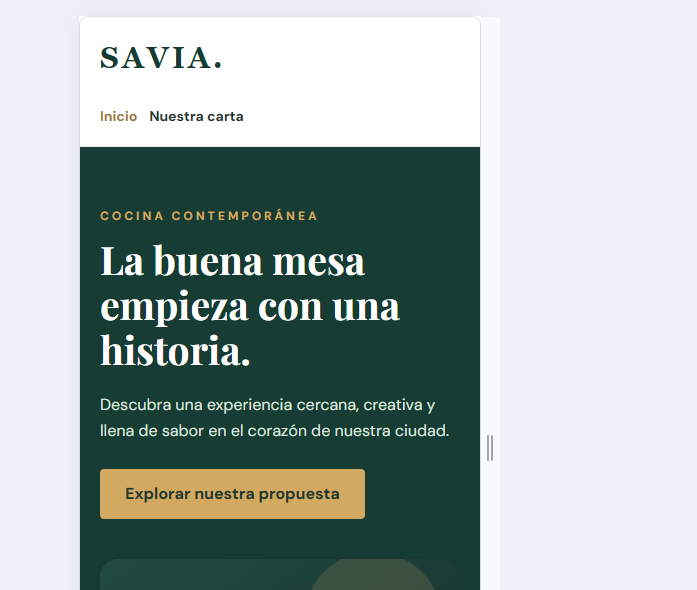
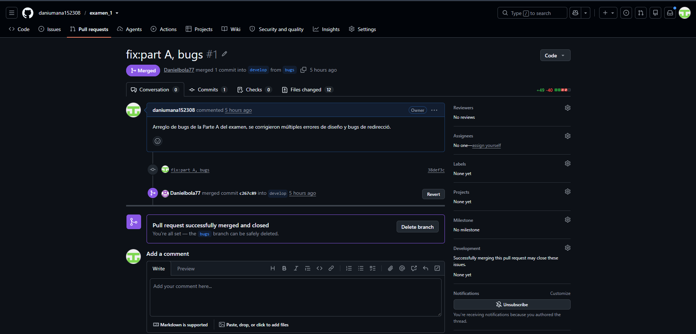

# SAVIA — examen N.º 1

Proyecto estático HTML + CSS. Abrir `index.html` en el navegador. No necesita dependencias.

El sitio incluye la página Inicio y las plantillas `pages/menu.html`, `pages/equipo.html` y `pages/eventos.html` con contenido central pendiente. Siga exclusivamente las especificaciones del examen para conocer el comportamiento esperado. No modifique el tema general ni sustituya el proyecto por otro.

## Diagnóstico de cinco incidencias

| N.º | Comportamiento observado | Causa técnica y ubicación | Corrección realizada | Prueba de verificación | Autor |
|---|---|---|---|---|---|
| 1 | Las tarjetas estaban una encima de la otra en patallas ancha.| Las tarjetas del feature-layout estaban en column, el error se ubicaba en style.css  |  Se uso flex direction row|  Inspeccione la pagina y la adapte a diferentes formas de pantallas|  Daniel Bolaños
| 2 |Al presionar el boton nuestra carta se manda a eventos |  en el href del ancor dirijia a eventos y no menu | en el header se arreglo el href y que agrego header a Nuestra carta | Me desplace por la pagina con los diferentes links| Daniel Bolaños |
| 3 | La oprimir el boton explorar nuestra propuesta no se redirije a la pagna deseada | tenia un # en el href por lo que l adirijia a la misma pagina | Se corrigieio poniendo pages/menu.html | Se navego por medio del boton asignado | Daniel Umaña |
| 4 | En el index.html estaba el boton Explorar nuestra propuesta de color rojo, aunque la clase btn estaba con color dorado, . |  Esto pasaba porque el hero-action tenia declarado el color rojo y ese boton leía ese color.| El color fue cambiado en el background-color del hero-action a color var--gold para que el boton quedara exactamente como tiene que quedar.|El botón se muestra de color dorado en la página. | Daniel Bolaños|
| 5 | Cuando el max-wigth era de 760px el logo se encontraba en la misma fila que el menu de navegación.|  El @media querie de styles.css tenía declarado el max-wigth en 760px.| Se corrigió en styles.css el max-wigth del @media a 375px|El menú de navegación se acomoda abajo del loo cuando llega a 375px de ancho. | Daniel Umaña|

## Responsables de las funcionalidades

| Estudiante | Página asignada | Rama | Commits principales | 
|---|---|---|---|
| Daniel Umaña Murillo| menu.html| feature_1|commits en feature_1  |
| Daniel Bolaños Alfaro| equipo.html| feature_2|commits en feature_2 y en la rama bugs |

## Evidencias Git

| Funcionalidad/corrección | PR hacia develop | Revisor | Resultado de merge / conflicto si ocurrió |
|---|---|---|---|
|fix: Arreglo de todos los bugs de la Parte A de el primer examen de Desarrollo de Software IV | | Daniel Bolaños Alfaro|Merged - No ocurrieron conflictos |
|feat: Pull request hacia develop de todos los cambios realizados en feature_1, agregando imagenes usadas para la creación de menu.html y su respectivo archivo css llamado menu.css | | Daniel Bolaños Alfaro| Merged - No ocurrieron conflictos|
|feat: Pull request hacia develop de todos los cambios realizados en feature_2, agregando imagenes usadas para la creación de equipo.html y su respectivo archivo css llamado equipo.css| |Daniel Umaña Murillo | Merged - No ocurrieron conflictos|
 
## Verificación final
Registrar las pruebas de funcionamiento a 1280 px y 375 px, enlaces y páginas.
